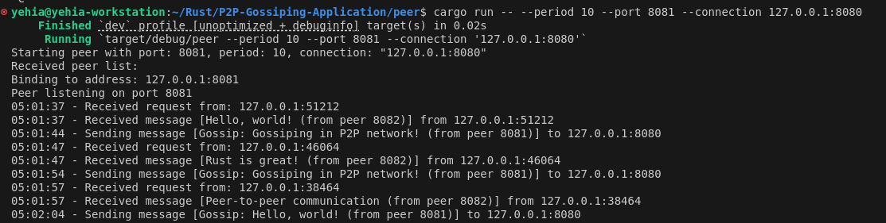

# P2P Gossiping Application

A peer-to-peer gossip protocol in Rust. Each peer listens on a TCP port, connects to a known peer, receives the current peer list, and then periodically broadcasts a gossip message to every peer it knows. Peers that disappear are dropped from the list, and the rest keep gossiping.

## Why it matters

Gossip is the building block behind membership and failure detection in systems like Cassandra and Consul. This project implements the core loop from scratch, without a framework, so every piece (discovery, fan-out, failure handling) is visible in a few hundred lines.



## How it works

1. The first peer starts with only a port and a period.
2. Each later peer starts with `--connection <host:port>` of any existing peer, requests its peer list, and connects to all of them.
3. Every `--period` seconds a peer sends a random gossip message to all connected peers and prints what it receives.
4. A failed connection removes that peer; the network continues without it.

## Tech stack

Rust (std networking, threads), Cargo. No external runtime.

## How to run

```bash
git clone https://github.com/YehiaSobeh/P2P-Gossiping-Application.git
cd P2P-Gossiping-Application/peer
cargo build
```

Start three peers in three terminals:

```bash
cargo run -- --period 5 --port 8080
cargo run -- --period 10 --port 8081 --connection 127.0.0.1:8080
cargo run -- --period 7 --port 8082 --connection 127.0.0.1:8080
```

Example output:

```
Starting peer with port: 8081, period: 10, connection: "127.0.0.1:8080"
Received peer list:
Binding to address: 127.0.0.1:8081
Peer listening on port 8081
05:01:37 - Received message [Hello, world! (from peer 8082)] from 127.0.0.1:51212
05:01:44 - Sending message [Gossip: Gossiping in P2P network! (from peer 8081)] to 127.0.0.1:8080
```

## Project structure

```
peer/src
├── cli.rs          CLI argument parsing
├── connection.rs   connections and peer-list requests
├── message.rs      random gossip message generation
├── peer.rs         core peer loop
└── main.rs         entry point
```

## What I learned

- Peer discovery is the hard part, not message passing: who tells a new node about the others, and what happens when that node is gone.
- Rust's ownership model forces you to decide up front which thread owns the peer list.
- Logging with timestamps on both send and receive is the only way to debug a distributed loop.
